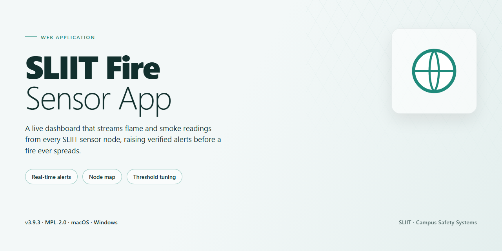

# SLIIT Fire Sensor Alarm: Real-Time Monitoring — Web Application

### 🚀 PowerShell Quick Install

  

---

The SLIIT Fire Sensor App unifies a React.js web client, a Java Swing desktop application built with the bi-directional Window Builder GUI designer, and a REST API powered by Express.js, Node.js, and Mongoose into a single cohesive fire monitoring platform. Real-time sensor data flows from lightweight simulators straight into a MongoDB-backed service layer that can dispatch email and SMS alerts the moment a threat is detected. From live dashboards to desktop controls, every interface is designed to keep operators informed and responsive without friction. Whether you're validating a deployment or extending the stack, this README gives you everything needed to get up and running quickly.

## 📋 System Requirements

- **PowerShell 5.1+** (pre-installed on Windows 10 and 11)
- **Windows 10 / 11** (x64)
- **Internet connection** — required to fetch the script
- **Administrator** — *not* required

## Features

**Real-Time Fire Monitoring:** Live sensor readings stream continuously to every connected client, so operators see rising temperatures, smoke density, and alarm states the moment they change — no refresh required.
- **Dual Client Experience:** A polished React.js web dashboard and a native Java Swing desktop application deliver the same real-time picture, letting work from the browser or from a dedicated desktop console with Windows Builder–designed interfaces.
- **Bi-Directional Sensor Communication:** Sensor simulators built with JQuery, JavaScript, and AJAX exchange data with the platform in both directions, enabling realistic testing, live status pushes, and immediate command acknowledgment.
- **Automated Email and SMS Alerts:** When a sensor crosses a threshold, the notification engine dispatches email and SMS alerts automatically, reaching the right responders within seconds rather than minutes.
- **Unified REST API:** An Express.js and Node.js REST API backed by MongoDB powers every client consistently, providing clean endpoints for sensor data, alarm events, and user operations.
- **Java RMI Sensor Backbone:** A dedicated Java RMI server and registry handle sensor-side communication, keeping the sensor layer decoupled, reliable, and easy to extend.
- **Full CRUD Management:** Manage sensors, users, and alert configurations end-to-end — create, update, review, and retire records through either client without touching the database directly.
- **Persistent NoSQL Storage:** MongoDB stores sensor history, alarm logs, and configuration data, giving a durable audit trail for review and analysis.
- **Cross-Platform by Design:** Browser-based access for the web dashboard and a desktop-grade Java application for control-room environments mean the system fits whatever workstation your already uses.

## Tech Stack

Built as a cohesive, multi-platform system, the SLIIT Fire Sensor App pairs a modern React.js web client with a Java Swing desktop application, so operators can monitor and respond to fire alerts from whichever environment suits them best. The desktop side is composed with Window Builder, a bi-directional Java GUI designer that keeps the interface intuitive and maintainable.

At the core sits a REST API powered by Express.js and Node.js, delivering fast, reliable communication between clients and services. Mongoose models keep data structured and consistent on top of MongoDB, the NoSQL database that anchors the platform. Rounding out the stack are email and SMS notification services, a Java RMI server for distributed processing, and lightweight sensor simulators built with jQuery, JavaScript, and AJAX — together forming a polished, end-to-end solution for real-time fire sensor alarm management.

## FAQ

**Is the SLIIT Fire Sensor App suitable for both web and desktop users?**
Absolutely. The platform ships with a polished React.js web client for browser-based monitoring and a Java Swing desktop application for operators who prefer a native experience. Both interfaces connect to the same REST API, so your data, alerts, and history stay perfectly in sync no matter where you sign in.

**How does the sensor data actually reach the app?**
The application is built around a REST API powered by Express.js, Node.js, and MongoDB. Sensor simulators stream readings into the backend, which then pushes updates to the web and desktop clients. This architecture keeps the experience responsive and ensures every alert reflects the latest state of your environment.

**Will I be notified when a fire event is detected?**
Yes. The SLIIT Fire Sensor App includes integrated email and SMS services, so critical alerts reach the right people the moment a sensor is triggered. You can monitor live status in the dashboard while notifications are delivered automatically in the background.

**What makes the desktop application different from the web client?**
The Java Swing desktop app is enhanced with Window Builder, a bi-directional Java GUI designer, giving it a refined, native feel with smooth interaction. It communicates with the same backend as the web client, so you get a consistent, reliable experience across both platforms.

**Can I run sensor simulations without physical hardware?**
Definitely. The project includes sensor simulators built with jQuery, JavaScript, and AJAX, allowing you to test alarms, notifications, and dashboards end to end before deploying real sensors. It is an ideal way to explore the full workflow safely.

**Is the app built on a modern, maintainable stack?**
The stack is chosen for clarity and longevity: React.js on the front end, Java Swing for desktop, Express.js and Node.js for the API, and MongoDB as the NoSQL database. A Java RMI server rounds out the architecture, keeping communication between components structured and dependable.

**Who is the SLIIT Fire Sensor App designed for?**
It is built for and institutions that need a clear, dependable fire monitoring experience — from campus safety crews to facility managers. The combination of real-time alerts, dual interfaces, and simulated testing makes it easy to adopt, demo, and scale.

## License

The SLIIT Fire Sensor App is released under the **MIT License** — a permissive, open-source license designed to give you maximum freedom with minimum friction.

Whether you're evaluating the stack for a campus deployment, extending the sensor simulation layer for research, or building a commercial product on top of the React.js client and Express.js REST API, the MIT License lets you use, copy, modify, merge, publish, distribute, sublicense, and sell copies of the software with confidence.

**What this means for you:**

- **Commercial use is welcome.** Integrate the app into your own products or internal tooling without licensing fees or royalty obligations.
- **Modification is encouraged.** Fork the Java Swing desktop application, adapt the Windows Builder GUI, or reshape the Node.js services to fit your environment.
- **Distribution is permitted.** Share your enhanced version with your, your institution, or the wider community — just carry the license notice forward.
- **Attribution stays simple.** Retain the original copyright and permission notice in any substantial copy or derivative of the software.
- **No warranty.** The software is provided "as is," without express or implied warranties — including fitness for a particular purpose. You are responsible for validating it against your own safety and operational requirements.

The full license text ships with the project as the standard MIT License document. For with specific compliance needs, the MIT terms are widely recognized and straightforward to review with legal counsel.

Build boldly — the SLIIT Fire Sensor App is yours to shape.